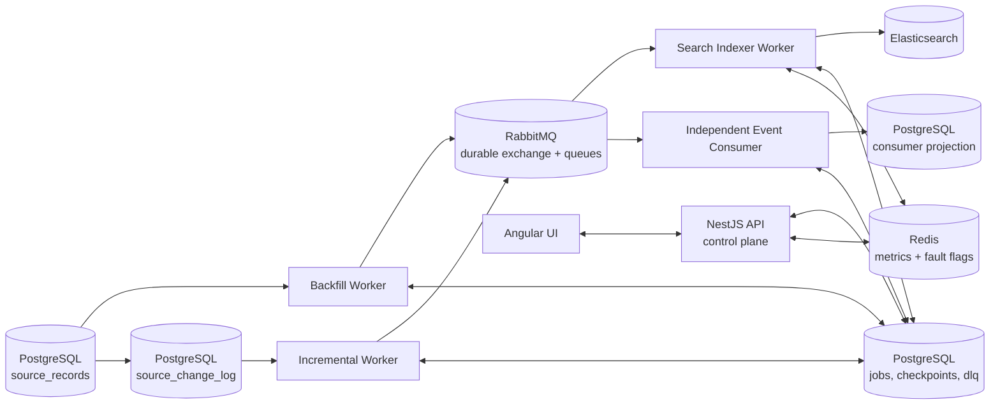

# Kill It Twice - Technical Specification

Status: SPEC v2 - implementation-ready architecture  
Repository: `kill_it_twice`  
Assignment: Optio Platform Team - Senior Software Engineer take-home

## 1. Purpose

Build a local, verifiable data replication system that copies records from a PostgreSQL source database into two independent receivers:

1. Elasticsearch, used as the searchable current-state sink.
2. RabbitMQ event stream, consumed by at least one independent consumer.

The assignment is primarily about failure behavior. The system must prove that it can survive process crashes, sink outages, duplicate delivery, partial batch failures, and operator pause/resume without losing source changes.

The declared delivery guarantee is:

```text
At-least-once delivery from source to RabbitMQ and RabbitMQ to consumers.
Effectively-once sink state through deterministic event IDs, monotonic versions, and idempotent writes.
```

The system does not claim true distributed exactly-once delivery.

## 2. Technology Stack and Scope

Use:

- NestJS + TypeScript for API and worker services.
- PostgreSQL for source records, source change log, durable checkpoints, DLQ, and verification state.
- RabbitMQ for durable event transport.
- Elasticsearch for searchable current-state projection.
- Redis only for live metrics cache, lightweight UI status, and local simulation flags.
- Angular for the dashboard/control UI.
- Docker Compose for local infrastructure.
- Make targets for seed and verification workflows.

Do not introduce Kafka, ClickHouse, NiFi, Kubernetes, cloud infrastructure, or extra distributed coordination. The system should be small enough to implement and verify within 10 days.

Redis is not part of the correctness path. If Redis restarts, checkpoints, events, DLQ entries, and replayability must remain intact.

## 3. Architecture



## 4. Source Change Model

### 4.1 Tables

`source_records` stores current source state.

Important fields:

- `id`: stable primary key, used for keyset pagination and Elasticsearch document ID.
- `version`: monotonic source version, assigned from the committed change sequence.
- `payload`: full current JSON payload.
- `deleted_at`: nullable soft-delete timestamp.
- `updated_at`: source update timestamp.

`source_change_log` is append-only.

Important fields:

- `seq`: global monotonic change sequence.
- `record_id`: source record ID.
- `operation`: `upsert` or `delete`.
- `version`: equal to `seq`.
- `payload`: complete post-change payload, not a partial patch.
- `deleted_at`: set for delete events.
- `created_at`: event creation time.

### 4.2 Atomic Source Writes

Every assignment-path source mutation must update `source_records` and append `source_change_log` in the same PostgreSQL transaction.

For upserts:

1. Acquire the source change clock lock.
2. Allocate the next `seq`.
3. Upsert `source_records` with `version = seq`, full payload, and `deleted_at = null`.
4. Insert `source_change_log` with the same `seq`, operation `upsert`, and complete post-change payload.
5. Commit.

For deletes:

1. Acquire the source change clock lock.
2. Allocate the next `seq`.
3. Update `source_records` with `version = seq` and `deleted_at = now()`.
4. Insert `source_change_log` with operation `delete`, the same `seq`, and enough tombstone payload to identify and replay the delete.
5. Commit.

Physical deletion from `source_records` must not be used by the assignment path. Deletes are soft and versioned so backfill can reason about records that change or are deleted while it scans.

### 4.3 Source Change Clock

Use a single-row PostgreSQL `source_clock` table as the only source sequence allocator and baseline serialization mechanism.

Minimal shape:

```text
source_clock(id primary key, last_seq bigint not null)
```

The table contains exactly one row, for example `id = 1`.

Source mutation transaction:

1. Begin PostgreSQL transaction.
2. Lock the clock row with `SELECT last_seq FROM source_clock WHERE id = 1 FOR UPDATE`.
3. Allocate `next_seq = last_seq + 1`.
4. Update `source_clock.last_seq = next_seq`.
5. Update `source_records` with `version = next_seq`.
6. Insert `source_change_log` with `seq = next_seq`, `version = next_seq`, and complete post-change payload or tombstone payload.
7. Commit.

Pipeline initialization transaction:

1. Begin PostgreSQL transaction.
2. Lock the same clock row with `SELECT last_seq FROM source_clock WHERE id = 1 FOR UPDATE`.
3. Use the locked row's `last_seq` as `baseline_seq`.
4. Create the pipeline baseline, backfill job, and incremental checkpoint in the same transaction.
5. Commit.

Why this is race-free:

- A source mutation holds the `source_clock` row lock until its source row and change-log row commit.
- Pipeline initialization waits for any in-flight source mutation holding that lock.
- While initialization holds the lock, no new source mutation can allocate a sequence.
- After initialization commits with `baseline_seq = source_clock.last_seq`, every later source mutation must allocate a sequence greater than `baseline_seq`.
- Therefore no source transaction with `seq <= baseline_seq` can commit after baseline creation.

## 5. Durable Pipeline Initialization

Pipeline initialization is a single PostgreSQL transaction protected by a pipeline initialization advisory lock and the `source_clock` row lock.

Initialization steps:

1. Acquire `pg_advisory_xact_lock('pipeline:init')` so only one initializer can run.
2. Lock the single `source_clock` row with `SELECT last_seq FROM source_clock WHERE id = 1 FOR UPDATE`.
3. Read `source_clock.last_seq`; call it `baseline_seq`.
4. Create or confirm the active pipeline row with that `baseline_seq`.
5. Create the backfill job with `upper_seq = baseline_seq`.
6. Initialize the incremental checkpoint to `last_published_seq = baseline_seq` if it does not already exist.
7. Commit all initialization rows together.

Definitions:

- `baseline_seq`: the durable source change boundary selected at pipeline initialization.
- `upper_seq`: the backfill ownership boundary; for v2, `upper_seq = baseline_seq`.
- `last_published_seq`: incremental cursor. On initial creation it equals `baseline_seq`.

Recovery rule:

```text
Recovery must never recompute the incremental checkpoint from current max(seq) or source_clock.last_seq.
```

If initialization crashes before commit, no partial initialization is valid. The next start retries initialization and may choose a later `baseline_seq`; no committed pipeline state existed, so no source change is skipped. If initialization commits and the process crashes immediately after, restart reuses the persisted `baseline_seq`, `upper_seq`, and checkpoints exactly as written.

## 6. RabbitMQ Message Model

Exactly one RabbitMQ message represents exactly one logical source event. A RabbitMQ message must never contain multiple source records.

The search worker may batch up to 500 individual RabbitMQ messages into one Elasticsearch bulk request, but acknowledgement, retry, and DLQ decisions are still made per message.

### 6.1 Message Schema

Each message contains:

- `event_id`
- `origin`: `backfill` or `incremental`
- `record_id`
- `version`
- `operation`: `upsert` or `delete`
- `payload`: complete post-change payload or delete tombstone payload
- `deleted_at`
- `source_seq`
- `baseline_seq`
- `job_id`
- `created_at`
- `metadata`: retry/replay fields that do not affect identity

Retry attempt, replay attempt, queue name, and delivery count must never change `event_id`.

### 6.2 Event Identity

Incremental event ID:

```text
change:<source_seq>
```

Backfill snapshot event ID:

```text
snapshot:<baseline_seq>:<record_id>:<version>
```

Crash recovery republishes the same logical event with the same `event_id`. DLQ replay also preserves the original `event_id`.

Duplicate events therefore have the same identity, and sink idempotency can treat them as harmless repeats.

## 7. Backfill Strategy and Boundary Correctness

The backfill worker scans `source_records` using keyset pagination. It never uses `OFFSET` and never loads the full dataset into memory.

Backfill query shape:

```sql
WHERE id > :last_record_id
  AND version <= :upper_seq
ORDER BY id
LIMIT :batch_size
```

Backfill owns only source records whose current `version <= upper_seq` at read time. Incremental sync owns all source changes with `seq > baseline_seq`.

Why changes cannot be missed:

- Any change committed before initialization has `seq <= baseline_seq`. If the record still has `version <= upper_seq`, backfill publishes its current state.
- Any change committed after initialization has `seq > baseline_seq` and is read by incremental sync.
- Source writes and initialization share the source clock, so a lower sequence cannot commit after the baseline has been selected.
- Incremental events contain full post-change payloads, so if backfill skips a row because its version became newer than `upper_seq`, the newer state still reaches sinks through incremental sync.

Record updated while backfill is scanning:

- If backfill already published the old version, incremental later publishes the newer version. Version-aware sinks make the newer version win.
- If backfill has not reached the row yet, the row now has `version > upper_seq`, so backfill skips it and incremental publishes the complete newer state.

Record deleted while backfill is scanning:

- Deletes are soft/versioned and append a delete event with `seq > baseline_seq`.
- If backfill already published the old state, the incremental delete tombstone later wins by version.
- If backfill has not reached the row yet, the row now has `version > upper_seq`, so backfill skips it and incremental publishes the delete tombstone.

RabbitMQ ordering between backfill and incremental messages is not required for correctness. Final sink state is determined by `record_id` and monotonic `version`.

## 8. Incremental Strategy

The incremental worker polls `source_change_log` using the durable cursor.

Incremental query shape:

```sql
WHERE seq > :last_published_seq
ORDER BY seq
LIMIT :batch_size
```

The worker publishes each change as one RabbitMQ message. It advances `last_published_seq` only after RabbitMQ publisher confirms every message through that sequence.

Incremental pause does not stop source writes. While incremental is paused, `source_change_log` grows and lag increases. Resume continues from the durable checkpoint.

## 9. Checkpoint Semantics and Crash Windows

### 9.1 Backfill Checkpoint

Backfill durable state:

- `job_id`
- `baseline_seq`
- `upper_seq`
- `last_record_id`
- `published_count`
- `status`
- `pause_requested`
- `updated_at`

Checkpoint rule:

```text
Advance last_record_id only after RabbitMQ confirms all messages for the current page.
```

Crash windows:

- Crash before publishing a page: checkpoint has not advanced; the page is retried.
- Crash after some messages are published but before all page confirms: checkpoint has not advanced; the whole page may be retried. Confirmed messages may duplicate.
- Crash after all page messages are confirmed but before checkpoint update commits: the whole page may be retried. All messages in the page may duplicate.
- Crash after checkpoint update commits: the page is complete and not retried by backfill.

Forbidden window:

```text
The checkpoint must never advance before all RabbitMQ confirms for the page are received.
```

This rule permits duplicates but prevents skipped source records.

### 9.2 Incremental Checkpoint

Incremental durable state:

- `last_published_seq`
- `published_count`
- `status`
- `pause_requested`
- `updated_at`

Checkpoint rule:

```text
Advance last_published_seq only after RabbitMQ confirms all messages up to and including that sequence.
```

Crash windows:

- Crash before publishing a batch: no checkpoint advance; events are retried.
- Crash after partial publish/confirm: checkpoint does not advance past unconfirmed events; confirmed messages may duplicate.
- Crash after all confirms but before checkpoint commit: the batch may be republished; messages duplicate with the same `event_id`.
- Crash after checkpoint commit: events through that sequence are complete.

No source event can be skipped because the cursor moves only after RabbitMQ durably accepts the corresponding messages.

### 9.3 Minimal Worker Resume Observation

For G1 only, workers record a minimal durable run observation in PostgreSQL. This is not a general audit system.

`worker_runs` stores one row per worker process start:

- `run_id`
- `worker_type`
- `started_at`
- `loaded_checkpoint_value`
- `first_work_start_value`

Backfill worker behavior:

1. On process start, read the durable backfill checkpoint.
2. Insert a `worker_runs` row with `loaded_checkpoint_value = last_record_id` before processing any page.
3. When the first page begins, update `first_work_start_value` to the same value used to build the first keyset query.

`make verify` uses this row to prove resume behavior:

- checkpoint before kill = `X`
- old worker is killed by `docker kill`
- restarted worker's `loaded_checkpoint_value = X`
- restarted worker's `first_work_start_value = X`
- subsequent checkpoint increases beyond `X`

This proves the restarted worker loaded and continued from the durable checkpoint rather than starting from zero.

## 10. RabbitMQ Topology and ACK Rules

Topology:

- Durable topic exchange: `replication.events`.
- Durable queue: `search.indexer`.
- Durable queue: `analytics.consumer`.
- Retry exchange and retry queues with TTL/dead-letter routing back to the target queue.
- Dead-letter exchange for broker-level failures.

Publishers:

- Use persistent messages.
- Use publisher confirms.
- Advance source checkpoints only after confirms.
- If any message in a page/batch is not confirmed, do not advance the checkpoint past it.

Consumers:

- Use manual acknowledgement.
- Use bounded prefetch.
- Never ACK before one of these durable outcomes exists:
  1. Sink processing succeeded.
  2. Durable retry publication is confirmed.
  3. Durable DLQ insertion is committed.

If a worker crashes after the sink operation succeeds but before RabbitMQ ACK, RabbitMQ redelivers the message. This is safe because sink writes are idempotent. If a worker crashes after retry publication but before ACK, both the original and retry may exist; this is safe because they share the same `event_id`. If a worker crashes after DLQ insertion but before ACK, the message may redeliver and attempt another DLQ insert; DLQ storage must be idempotent on target plus `event_id` plus failure class.

## 11. Elasticsearch Idempotency and Versioning

Elasticsearch document ID is deterministic:

```text
_id = record_id
```

Each indexed document stores:

- `record_id`
- `version`
- `payload`
- `deleted`
- `deleted_at`
- `updated_at`

Use Elasticsearch bulk `update` operations with `scripted_upsert` and `retry_on_conflict` set to a small bounded value, for example `3`. The script is the concrete idempotency mechanism; `retry_on_conflict` only handles concurrent update conflicts and does not replace the version check.

Required update behavior:

```text
if document is missing:
  create it through scripted upsert from the incoming event
else if incoming.version > stored.version:
  replace stored payload/tombstone fields with incoming event
else if incoming.version == stored.version:
  apply the same logical state again; final document remains unchanged
else:
  no-op because the incoming event is older
```

Upsert handling:

- `upsert` events set `deleted = false`, `deleted_at = null`, store the incoming payload, and store the incoming version.
- Missing documents are created by the same script path, so an incremental event can create the document even if backfill has not reached it.

Tombstone handling:

- `delete` events are tombstones, not physical Elasticsearch deletes.
- A tombstone sets `deleted = true`, stores `deleted_at`, stores minimal tombstone payload, and keeps the latest version.
- Search queries exclude tombstones by default.

Version behavior:

- Newer version: applied and becomes the stored state.
- Equal version: harmless duplicate; final state is unchanged.
- Older version: explicit no-op; it cannot overwrite newer state.

Concurrent and out-of-order handling:

- If version 6 arrives before version 5, version 6 is stored and version 5 later no-ops.
- If version 5 arrives before version 6, version 6 later replaces it.
- Duplicate version 6 events leave the same final state.
- Elasticsearch internal version conflicts after `retry_on_conflict` exhaustion are treated as retryable failures. The script remains the final correctness guard.

This is intentionally simpler than external versioning or distributed transactions and is sufficient for local verification.

## 12. Independent Event Consumer Idempotency

The independent consumer writes an event ledger table with unique `event_id`.

Rules:

- Insert into `consumer_events(event_id, record_id, version, operation, payload)`.
- If `event_id` already exists, treat it as duplicate success.
- Update the projection row only if `incoming.version >= stored.version`.
- Older events do not overwrite newer projection state.

This gives the same effectively-once final state as Elasticsearch while proving the RabbitMQ event stream has an independent consumer.

## 13. Retry and DLQ Strategy

### 13.1 Failure Classification

Retryable failures:

- Elasticsearch unavailable.
- HTTP 429 or 503.
- Network timeout.
- RabbitMQ reconnect.
- Elasticsearch internal version conflict.

Terminal failures:

- Payload cannot be transformed.
- Deterministic validation failure for poison data.
- Deterministic mapping conflict for one event.
- Any item-level error classified as non-retryable by the search worker.

Unknown failures are retried first. If they exceed the configured retry policy, they move to DLQ.

### 13.2 Retry Policy

Retryable failures use capped exponential backoff with jitter:

- 5 seconds
- 15 seconds
- 30 seconds
- 60 seconds maximum delay

Default max retry policy:

- `max_retry_attempts = 20`
- `max_retry_age = 15 minutes`

An event moves to DLQ after retry policy exhaustion. `VERIFY_FAST=1` may shorten delays and retry age while preserving the same state transitions.

A short Elasticsearch outage must not immediately DLQ messages. During G3, retryable events should remain in durable queues and recover automatically when Elasticsearch returns.

### 13.3 DLQ States

DLQ items have exactly these states:

- `open`: failed and awaiting operator action or automatic replay decision.
- `replay_pending`: replay was requested and the original event has been or is being republished.
- `resolved`: the replayed event was processed successfully or the item was explicitly marked resolved after verification.

DLQ item identity is idempotent by:

```text
target + event_id + failure_class
```

### 13.4 DLQ Insertion and ACK Ordering

For terminal failure:

1. Insert or update the DLQ item in PostgreSQL.
2. Commit the DLQ transaction.
3. ACK the RabbitMQ message.

Never ACK a terminal failure before the DLQ insert commits.

For retryable failure:

1. Publish retry message with the original `event_id` and updated retry metadata.
2. Wait for RabbitMQ confirm.
3. ACK the original message.

Never ACK a retryable failure before durable retry publication is confirmed.

### 13.5 Replay Semantics

Replay preserves the original `event_id`, `record_id`, `version`, `operation`, and payload. Replay metadata is separate and does not change event identity.

Replay flow:

1. Operator or verification script requests replay for an `open` item.
2. Mark item `replay_pending`.
3. Republish the original event to the correct target queue with original `event_id`.
4. Wait for publisher confirm.
5. The target consumer processes the event normally.
6. On successful target processing, mark the DLQ item `resolved`.
7. If the event fails again, update the DLQ item and return it to `open` or keep it `replay_pending` with the latest failure details.

Crash during replay:

- Crash before republish confirm: item remains `replay_pending`; replay can be retried.
- Crash after republish confirm but before state update: event may be in RabbitMQ and item may still appear pending; replaying again is safe because `event_id` is unchanged.
- Crash after target success but before marking `resolved`: replay may be attempted again; idempotency makes it safe.

## 14. Partial Elasticsearch Bulk Failure / G4

The normal search worker may collect up to 500 RabbitMQ messages and send one Elasticsearch bulk request.

For deterministic G4 verification, `VERIFY_FAST=1` or an equivalent verification mode must force:

- Elasticsearch bulk size exactly `500`.
- Exactly `500` individual RabbitMQ messages selected for the test bulk group.
- Exactly `3` messages marked as deterministic terminal poison events.
- Exactly `497` valid messages.
- One Elasticsearch bulk request containing those `500` items.

Rules:

- Each RabbitMQ message is one source event.
- Each Elasticsearch bulk item maps to exactly one RabbitMQ message.
- Each bulk item result is handled independently.
- Successful item: ACK that message.
- Older-version no-op: ACK that message as successful idempotent processing.
- Terminal item failure: write DLQ item, commit, then ACK that message.
- Retryable item failure: publish durable retry, confirm, then ACK original message.
- Whole bulk request failure with unknown item results: retry all messages; idempotency handles any duplicate writes.

One failed item must never roll back or block successful items from the same bulk request.

## 15. Pause and Resume Semantics

Pause is cooperative, not a process kill.

Backfill pause:

1. API sets `pause_requested = true` for the backfill job.
2. Worker observes the flag between pages.
3. If a page is already in progress, the worker finishes publishing it, waits for confirms, commits the checkpoint, then enters `paused`.
4. Resume clears the flag and continues from durable `last_record_id`.
5. Resume never recomputes `baseline_seq` or `upper_seq`.

Incremental pause:

1. API sets `pause_requested = true` for incremental sync.
2. Worker observes the flag between batches.
3. If a batch is in progress, it finishes publishing, waits for confirms, commits `last_published_seq`, then enters `paused`.
4. Source changes may continue to accumulate while paused; incremental lag increases.
5. Resume continues from durable `last_published_seq` and never recomputes `baseline_seq`.

Backfill pause does not imply incremental pause. Incremental pause does not imply backfill pause.

## 16. Backpressure and Outage Behavior

The system must hold backlog in durable queues and PostgreSQL state, not in process memory.

Required bounds:

- RabbitMQ consumer prefetch is bounded. For the search worker, prefetch should be at or near the max bulk size, default 500.
- Elasticsearch bulk buffer is bounded by message count, default 500, and by approximate byte size.
- Retry delay is capped with jitter; workers must not tight-loop on failing sinks.
- Publisher batches are bounded.
- API/status queries must not load full datasets into memory.

Elasticsearch multi-minute outage behavior:

1. Search worker detects retryable failures.
2. Circuit breaker opens after a small number of consecutive failed bulk attempts.
3. While open, the worker schedules durable retries with capped backoff and avoids immediate repeated calls to Elasticsearch.
4. RabbitMQ queue/retry depth grows durably.
5. Process memory remains bounded by prefetch and bulk buffer limits.
6. When Elasticsearch health checks pass, the circuit breaker half-opens and normal processing resumes.
7. Queues drain and final sink state catches up.

Optional publisher high-watermark:

- If RabbitMQ search queue plus retry queue depth exceeds a configured threshold, backfill and incremental workers sleep before publishing more pages/batches.
- This is a local safety valve, not a correctness requirement.

## 17. Observability Requirements

`GET /api/pipeline/status` must expose enough information for G5 to verify system state without reading code.

Required fields:

- `baseline_seq`
- `source_max_seq`
- `backfill.status`
- `backfill.upper_seq`
- `backfill.last_record_id`
- `backfill.published_count`
- `backfill.throughput_per_sec`
- `backfill.pause_requested`
- `incremental.status`
- `incremental.last_published_seq`
- `incremental.lag_count = source_max_seq - last_published_seq`
- `incremental.lag_oldest_age_seconds`
- `incremental.throughput_per_sec`
- `rabbitmq.search_queue_depth`
- `rabbitmq.analytics_queue_depth`
- `rabbitmq.retry_queue_depth`
- `dlq.open_count`
- `dlq.replay_pending_count`
- `dlq.resolved_count`
- `search.indexed_count`
- `search.retry_count`
- `search.circuit_breaker_state`
- `consumer.processed_event_count`
- `consumer.duplicate_event_count`
- component health for PostgreSQL, RabbitMQ, Elasticsearch, Redis, API, workers
- latest structured error per component, if any

Structured logs must include `job_id`, `event_id`, `record_id`, `version`, `source_seq`, `origin`, `target`, `attempt`, and `error_class`.

The Angular UI must display pipeline state, searchable data, DLQ/replay controls, and simulation controls. It does not need production-grade design polish.

## 18. Dataset and Capacity

Default seed target:

```text
SEED_COUNT=200000
```

`make seed` must accept configurable `SEED_COUNT`. The capacity test target is approximately 1,000,000 records, documented in README if run locally.

Payload size should be realistic enough to prevent the assignment from becoming a trivial counter test. Default payload should be approximately 1 KB JSON per record, with a mix of searchable fields, status fields, timestamps, and nested attributes.

The implementation must use bounded/keyset processing regardless of default dataset size:

- Backfill uses keyset pagination.
- Workers use bounded batches.
- RabbitMQ prefetch is bounded.
- Elasticsearch bulk requests are bounded.
- Verification count/diff queries avoid loading all records into application memory.

200,000 records is the default local proof size. The stronger proof is the implementation shape plus capacity notes showing how the same code path scales toward 1,000,000 records.

## 19. API Surface Draft

This is expected behavior, not implementation code.

- `GET /api/health`
- `GET /api/pipeline/status`
- `POST /api/pipeline/backfill/start`
- `POST /api/pipeline/backfill/pause`
- `POST /api/pipeline/backfill/resume`
- `POST /api/pipeline/incremental/pause`
- `POST /api/pipeline/incremental/resume`
- `GET /api/records`
- `GET /api/records/:id`
- `GET /api/events/recent`
- `GET /api/dlq`
- `POST /api/dlq/:id/replay`
- `POST /api/simulations/source-changes`
- `POST /api/simulations/poison-records`
- `POST /api/simulations/sink-outage`

Any internal verification-only endpoint must be documented in README.

## 20. Deterministic Verification Strategy

`make verify` is the main deliverable. It must run G1-G5 automatically and print PASS/FAIL with a short explanation.

Each gate should reset or isolate its state enough to be deterministic. Verification may use `VERIFY_FAST=1` to shorten sleeps/retry delays while preserving the same correctness rules.

### G1 - Crash Recovery

Setup:

- Reset environment.
- Seed with deterministic data.
- Start Docker Compose with separate backfill worker container.
- Start backfill with a throttle so progress is observable before completion.
- Enable the minimal `worker_runs` observation described in section 9.3.

Action:

- Wait until `backfill.last_record_id` exceeds a threshold.
- Read the durable checkpoint; call it `X`.
- `docker kill` the backfill worker container and verify that the old container/process exited.
- Restart the worker.
- Read the new worker's `worker_runs` row.
- Wait for backfill and queues to drain.

Expected state:

- The killed worker had already committed checkpoint `X`.
- The restarted worker loaded checkpoint `X` before processing.
- The restarted worker's first keyset page begins from `X`, not zero.
- Final Elasticsearch and independent projection states match source state for eligible records.
- Any duplicate messages from the killed page are harmless.

Exact assertions:

- Durable checkpoint before kill equals `X` and `X > 0`.
- `docker kill` succeeds and the old worker run stops heartbeating or exits.
- The first `worker_runs` row for the restarted backfill worker has `loaded_checkpoint_value = X`.
- The same row has `first_work_start_value = X`.
- The later durable checkpoint becomes greater than `X`.
- Source current count equals search current count, excluding intentional DLQ poison records.
- Projection versions match source versions.
- No missing record IDs in sink comparison.

Failure condition:

- The restarted worker loads `0` or any value other than `X`, starts its first page from zero, skips records, loses records, or cannot complete after restart.

### G2 - No Duplicates / Idempotency

Setup:

- Reset and seed.
- Start backfill and incremental sync.
- Enable deterministic source-change generation during processing.
- Select one committed source change event as the duplicate probe; record its `event_id`, `record_id`, and `version`.

Action:

- Restart backfill, incremental, search indexer, and event consumer workers several times while messages are in flight.
- Continue generating source changes during restarts.
- Intentionally deliver the duplicate probe event more than once to each target queue with the exact same `event_id`, `record_id`, `version`, operation, and payload.
- Wait for all queues to drain.

Expected state:

- Duplicate deliveries definitely occurred, including the deterministic duplicate probe.
- Final sink state is effectively once.
- Repeated processing of the same logical event is harmless.

Exact assertions:

- Verification observes at least two processing attempts for the duplicate probe `event_id` through worker metrics/logged counters or a minimal processing-attempt counter.
- The event ledger has exactly one logical row for the duplicate probe `event_id`.
- The projection has exactly one current row for the duplicate probe `record_id`.
- The projection version for that `record_id` equals the expected latest source version.
- Elasticsearch has at most one current document per `record_id`.
- Elasticsearch stored `version` equals source `version` for every non-DLQ current record.
- Projection table has one row per current `record_id` and matching latest version.
- Duplicate delivery counter is greater than zero, but duplicate final rows are zero.

Failure condition:

- The deterministic duplicate creates two logical ledger rows, creates duplicate final projection/search state, changes the final version incorrectly, or allows an older version to overwrite a newer version.

### G3 - Elasticsearch Outage Recovery

Setup:

- Reset and seed.
- Start pipeline.
- Ensure search worker is actively indexing.

Action:

- Stop Elasticsearch container or activate an equivalent real outage path used by `make verify`.
- Keep the outage for a deterministic interval.
- Continue allowing backfill/incremental publication.
- Restart Elasticsearch.
- Wait for retry queues and search queue to drain.

Expected state:

- Backlog accumulates durably in RabbitMQ/retry queues.
- Search worker does not busy-loop.
- No events are lost.
- Index catches up after Elasticsearch returns.

Exact assertions:

- Search queue or retry queue depth rises during outage.
- Retry/circuit-breaker metrics show bounded retry rate.
- Process does not exceed configured prefetch/bulk memory bounds.
- After recovery, queue depth returns to zero or expected DLQ-only remainder.
- Final search versions match source versions for non-DLQ records.

Failure condition:

- Messages are ACKed and lost during outage, worker busy-loops, memory grows unbounded, or recovery requires manual replay for retryable outage events.

### G4 - Partial Batch Failure

Setup:

- Reset environment or isolate the test dataset.
- Enable verification mode that forces Elasticsearch bulk size exactly `500`.
- Generate exactly `500` source events for the search worker's test bulk group.
- Mark exactly `3` of those events as deterministic terminal poison for Elasticsearch.
- Ensure the remaining `497` events are valid.

Action:

- Let the search worker select exactly those 500 individual RabbitMQ messages.
- Send exactly one Elasticsearch bulk request containing those 500 items.
- Handle each item result independently.

Expected state:

- The one bulk request contains exactly 500 items.
- Exactly 497 valid items are committed independently.
- Exactly 3 failed items are isolated in DLQ.
- The whole bulk group is not rolled back.

Exact assertions:

- Verification records one Elasticsearch bulk request for the G4 group with `bulk_item_count = 500`.
- 497 messages are ACKed after successful Elasticsearch processing.
- 3 messages have committed DLQ rows with state `open` and replay context.
- Search index contains the 497 valid updates.
- DLQ entries preserve original `event_id`.
- RabbitMQ has no unacked messages for the completed valid items.
- No valid item from the 500-message group is rolled back because of the 3 poison items.

Failure condition:

- The test processes fewer or more than 500 messages, uses more than one bulk request for the G4 group, one poison record blocks or rolls back valid records, the 3 failures disappear without DLQ, or ACK happens before DLQ commit.

### G5 - Observability

Setup:

- Run pipeline with backfill activity, incremental activity, and at least one DLQ item.

Action:

- Query `GET /api/pipeline/status` and any documented verification status endpoints.

Expected state:

- Status and metrics are sufficient to explain where the pipeline is and whether it is healthy.

Exact assertions:

- Response includes all required fields listed in section 17.
- `incremental.lag_count` equals `source_max_seq - last_published_seq`.
- DLQ counts match PostgreSQL `dlq_items` by state.
- Queue depth fields match RabbitMQ management/API checks used by verify.
- Component health reflects actual PostgreSQL, RabbitMQ, Elasticsearch, Redis, API, and worker status.
- Throughput fields are numeric and update while work is active.

Failure condition:

- A reviewer cannot answer progress, throughput, lag, DLQ count, or health from metrics/UI/API without reading code.

## 21. Make Targets

Required:

- `make seed`: reset and generate source data with configurable `SEED_COUNT`.
- `make verify`: run G1-G5 and print PASS/FAIL.

Expected local workflow:

- `docker compose up`: starts infrastructure, API, workers, and UI.
- `make seed`: creates test data.
- `make verify`: runs deterministic gate checks.

`make verify` may call Docker Compose internally and should leave a short verification artifact for debugging.

## 22. README Requirements

README must include:

- Prerequisites.
- Run instructions.
- Seed instructions.
- Verify instructions.
- Architecture diagram.
- Delivery guarantee declaration.
- Gate table with PASS/FAIL.
- Capacity notes: measured throughput, bottleneck, and what would change to double throughput.
- At least four ADRs.
- "What I did not build and why."
- "Where AI diverged from the spec" with at least two concrete cases.

## 23. Known Trade-Offs

1. Application-managed change log instead of WAL CDC:
   - Simpler and deterministic for a take-home.
   - Less production-realistic than Debezium or logical replication.

2. At-least-once plus idempotency instead of exactly-once:
   - Honest for PostgreSQL, RabbitMQ, and Elasticsearch without distributed transactions.
   - Requires stable event IDs and version-aware sinks.

3. Single backfill scanner:
   - Easier to reason about and verify.
   - Lower peak throughput than partitioned scanning.

4. Elasticsearch tombstones:
   - Makes out-of-order deletes and older upserts safe.
   - Requires search queries to exclude deleted documents.

5. Polling incremental sync:
   - Simple and testable.
   - Adds small polling latency.

6. Redis as non-critical helper:
   - Keeps correctness in PostgreSQL and RabbitMQ.
   - UI metrics may be briefly stale after Redis restart.

## 24. Scope Exclusions

V2 intentionally excludes:

- True distributed exactly-once transactions.
- PostgreSQL WAL/logical replication integration.
- Kafka.
- ClickHouse.
- Apache NiFi.
- Kubernetes.
- Cloud infrastructure.
- S3 integration.
- Multi-tenant auth or RBAC.
- Production TLS/secrets management.
- Highly polished product UI.
- Horizontal backfill partitioning unless capacity measurement proves it is necessary.
- Advanced Elasticsearch relevance tuning.

## 25. SPEC v2 Decisions

Resolved decisions for implementation:

1. Pipeline initialization is a single durable transaction protected by the pipeline advisory lock and the single-row `source_clock` lock.
2. `source_clock` is the sequence allocator; source mutations lock it with `SELECT ... FOR UPDATE`, allocate `last_seq + 1`, and commit source row plus change-log row atomically.
3. `baseline_seq` is read from the locked `source_clock.last_seq`, persisted once, and never recomputed during recovery.
4. `upper_seq = baseline_seq` for the backfill job.
5. Incremental starts from `last_published_seq = baseline_seq` on first initialization only.
6. Source writes atomically update `source_records` and append full-payload `source_change_log` events.
7. Assignment-path deletes are soft/versioned; physical source deletes are not used.
8. RabbitMQ message granularity is exactly one logical source event per message.
9. Incremental event IDs are `change:<source_seq>`.
10. Backfill event IDs are `snapshot:<baseline_seq>:<record_id>:<version>`.
11. Retry/replay metadata never changes `event_id`.
12. G1 uses a minimal durable `worker_runs` observation to prove the restarted worker loaded checkpoint `X` and began processing from `X`.
13. G2 intentionally redelivers the same logical event and proves one ledger entry, one final projection state, and correct version.
14. Elasticsearch uses deterministic `_id = record_id`, scripted upsert version checks, tombstones, explicit older-version no-ops, and bounded `retry_on_conflict`.
15. RabbitMQ ACK occurs only after sink success, confirmed durable retry publication, or committed DLQ insertion.
16. G4 verification forces exactly one 500-item Elasticsearch bulk request containing exactly 497 valid events and 3 terminal poison events.
17. DLQ states are exactly `open`, `replay_pending`, and `resolved`.
18. Pause/resume is cooperative and checkpoint-based.
19. Multi-minute Elasticsearch outages are absorbed by durable RabbitMQ/retry queues with bounded worker memory.
20. Default seed target is 200,000 records with approximately 1 KB payloads.
21. Capacity target is approximately 1,000,000 records, documented if measured.
22. `make verify` must deterministically test G1-G5 using the assertions in this SPEC.

